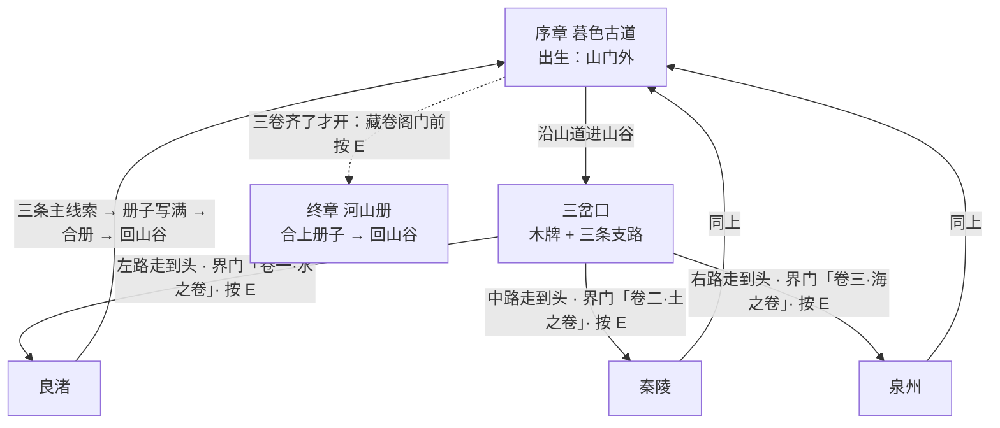

# 《华夏文明探源 · 河山册》互动脚本 · 现状全表

> 这份文档是**照当前代码逐条读出来的**，不是设计愿望。
> 通读一遍，凡是「按 E 之后会看到什么」跟你想的不一样，划出来告诉我，我再改。
> 依据文件：`Assets/Huaxia/Scripts/**`、`Assets/Huaxia/Editor/**`（不引用策划案）。

---

## 1. 玩家能做的全部动作

### 1.1 键位总表（桌面端）

| 键 | 生效条件 | 效果 |
|---|---|---|
| `W A S D` | 指针锁定、无弹窗 | 前后左右走（有地形碰撞、台阶 0.35 m 自动迈上） |
| `Shift`（按住） | 同上 | 跑 |
| 鼠标移动 | 同上 | 转视角，俯仰 ±80° |
| 鼠标左键 | 指针已释放 | 重新锁定指针 |
| `E` | 指针锁定、无弹窗、准星前 ≤4.5 m 有互动点 | 触发该互动 |
| `E` | 站在某道界门／界石的感应圈里 | 过界去下一场景 / 回山谷 |
| `空格` / `Enter` / 鼠标左键 | 弹窗打开 | 确认（有动作就执行） |
| `Esc` | 弹窗打开 | 关掉弹窗 |
| `Esc` | 指针锁定 | 松开鼠标 |
| `Tab` | 弹窗、过场之外 | **取出／收起《河山册》** |
| `→` / 滚轮下 | 册子**已抬起** | 翻下一页 |
| `←` / 滚轮上 | 册子已抬起 | 翻上一页 |
| `V` | 三个遗址场景内 | 人视 ⇄ 鸟瞰（序章、终章没有） |
| `R` | **仅 Unity 编辑器内**、无弹窗 | 回本场景落点（进这一场时站的地方；终章里就是案前） |
| `Shift + R` | 同上 | 跨场景回整局出发点：序章山门外（调试用，打包后没有这两个键） |

> **本轮拆分（原 P0-1）**：`E` 只做世界交互，不再兼任「弹窗确认」和「翻页」。以前抬手翻页会顺手按开身后的界门，是这个作品最实的一个误触。

### 1.2 三条反馈通道

1. **准星提示**：准星右下方浮一行「[E] 查看线索」。移开就消失。
2. **界门提示**（sticky）：走进界门 3.15 m，屏幕下方常驻一行字，走出去才收。别的提示抢不走它。
3. **册子**：默认**垂在腰侧、不出画面**。按 `Tab` 才抬到眼前，翻页看已记下的东西。

---

## 2. 全流程路径



- 三卷**不分先后**，走哪条都行。
- 从遗址回来，人站在**那条路的路口**（面朝山谷），不是被扔回山门外。
- 藏卷阁的门在三卷没齐时不说话地立着：走近只显示「还差几卷没走完」，按 E 弹一句「还差 N 卷」。

---

## 3. 序章 · 暮色古道

### 3.1 进场

- 标题：`暮色古道`　副标题：`序章`
- 右侧目标栏：

```
眼下
◇ 顺着山道走进山谷，到三岔口
◇ 到路口那块木牌前站一下
◇ 挑一条路走到头，站定了按 E
◇ 亭子里那半卷残卷，可以翻一翻

按 E 说话 / 进门　Tab 翻册子
```

- 顶部一句话：`你手里只有半卷《河山册》。往山谷里走，三条岔路各通一处遗址。`
- 书：开场不自动抬，按 `Tab` 才取。

### 3.2 三岔口的木牌

| 触发体 | 提示 | 按 E 之后 |
|---|---|---|
| 路引木牌（z −17，牌坊里侧偏东） | `[E] 读路引` | 弹窗「三卷分路」：三条路各通哪里，走到路尽头怎么过界 |

三根望柱（路口正中一排，感应 2.3 m）只回答「这条路去哪」，**不传送**——真正过去的地方在路尽头。

| 望柱 | 提示 | 按 E 之后 |
|---|---|---|
| 左「卷一 · 水之卷」 | `[E] 走进「卷一 · 水之卷」` | 弹窗：左路通良渚，一直走到路尽头那块石头跟前按 E |
| 中「卷二 · 土之卷」 | `[E] 走进「卷二 · 土之卷」` | 弹窗：中路通秦陵，过界门往上就是封土 |
| 右「卷三 · 海之卷」 | `[E] 走进「卷三 · 海之卷」` | 弹窗：右路通泉州，从码头走到九日山 |

### 3.3 三条路的尽头（界门）

每道门：门前石坪、两根石柱、木楣、匾额（卷一/卷二/卷三）、门后山石 + 松 + 竹（把视线收住）。
匾额朝来路，站在路上就能读到；门旁一块界石写着地名和「路，到这儿为止」。

| 门 | 位置 | 走进感应圈显示 | 按 E |
|---|---|---|---|
| 界门「卷一 · 水之卷」 | 左路尽头 | `[E] 走进「良渚」　—— 路到这儿就是尽头了` | 淡黑 → 落到良渚 |
| 界门「卷二 · 土之卷」 | 中路尽头偏西（让开甬道） | `[E] 走进「秦陵」　—— 路到这儿就是尽头了` | 淡黑 → 落到秦陵 |
| 界门「卷三 · 海之卷」 | 右路尽头 | `[E] 走进「泉州」　—— 路到这儿就是尽头了` | 淡黑 → 落到泉州 |

回落点：`back_liangzhu` / `back_qinling` / `back_quanzhou`，站在门下 3.7 m、面朝山谷——离感应圈 3.15 m 差 0.5 m，不会被回程立刻又送回去。

### 3.4 藏卷阁（终章入口）

| 触发体 | 三卷齐了吗 | 显示 | 按 E |
|---|---|---|---|
| 藏卷阁门前（z 35.2，感应 2.6 m） | 没齐 | `藏卷阁的门还没开　—— 还差几卷没走完` | 弹窗「还差 N 卷」，告诉你回去把没走完的路走完，界石旁按 E 就回去 |
| 同上 | 齐了 | `[E] 进藏卷阁` | 淡黑 → 终章 |

### 3.5 三间屋子（都是装饰，但说明白了）

| 屋子 | 门楣木牌 | 说明 |
|---|---|---|
| 藏卷阁（主楼） | `藏卷阁` | 终章入口，三卷齐了才进 |
| 西配殿 | `抄书处` / `纸还没裁完` | **门是锁死的**（有碰撞），只在门口看 |
| 东配殿 | `值房` / `守山人住的地方` | 同上 |

以前能走进空屋子、屋里还长着一棵树（树穿屋顶）；现在门封住、树移走。

### 3.6 其它可互动

- 问道亭里的半卷残卷：`[E] 翻一翻这半卷`——只给一句气氛文字，不是线索。
- 水潭、石桥、香炉：纯观赏。

---

## 4. 三个遗址（结构一致，只是内容不同）

进场 → 弹窗（标题 / 一句话 / 正文）→ 右侧目标栏列出 3 条主线 + 若干可选。

**进场处的界石**（本轮新增）：来路边立一块石，正面写「界石 / 地名 / 顺来路，回山谷」。
走近 2.8 m 常驻一行 `[E] 回山谷　—— 顺着来路走回去`，按 E 就回序章那条岔路的尽头
（`back_liangzhu` / `back_qinling` / `back_quanzhou`）。不用把这一卷走完也能走。
界石离出生点 3.8 m 以上，落地时不会被立刻送回。

| 场景 | 弹窗标题 | 主线目标 |
|---|---|---|
| 良渚 | 卷一 · 水之卷 | 稻田与村落 / 城墙水门河道 / 莫角山台地 / 反山玉器（另 3 条可选） |
| 秦陵 | 卷二 · 土之卷 | 城垣夯层 / 陪葬坑 / 封土（另 3 条可选） |
| 泉州 | 卷三 · 海之卷 | 码头栈桥 / 干坞十三舱 / 三教碑（另 3 条可选） |

每条线索：`[E] 查看线索` → 弹窗（标题 / 副标题 / 正文 / 史实分层角标 `● 已证实` `○ 学界推断` `△ 艺术处理`）。
触发后提示变 `[E] 回顾`，核心球发光降到 12%。

**主线走完** → 册子那几页写满 → 弹窗「这一卷记完了」→ 按 E 合册 → 淡黑 → 回山谷 `back_*` 落点。
可选线索不卡进度。

---

## 5. 终章 · 河山册

- 落点 `epilogue_start`，标题 `河山册` / `终章`。
- 目标栏：`走到案前，看看摊开的那本书` / `最后一叶，等你合上`。
- 顶部一句话：`三处都去过了。案上摊着那本册子，最后一叶还是空的。`
- 案上的书：`[E] 合上` → 淡黑 → 一句话「此页留给后来者。」→ 回到山谷 `after_epilogue`（山道上，面朝山谷）。

---

## 6. 还没做的（我列的，等你点头）

| 编号 | 内容 | 状态 |
|---|---|---|
| B3 | 册子翻页音效 | ✅ 已做：`Audio/page_turn.wav`，`Tools/Audio/generate_page_turn.py` 合成，每次音高略变 |
| B4 | 界门过场 | ✅ 已做「黑场字幕」：淡黑后在黑上留 0.85 秒地名（如「卷一 · 水之卷　良渚」）。门缝透光还没做 |
| B5 | 遗址里中途回山谷的「界石」 | ✅ 已做：三处遗址入口各一块，`[E] 回山谷` |
| B6 | 手柄 / 头显映射 | 🟡 代码已接（`XRInputBridge`：左摇杆走、右摇杆整步转身、右手扳机互动/确认、左手 grip 取册、A 确认、B 取消），OpenXR 加载器配置见 `XRSetup`；**尚未在 PICO 4 真机验证** |
| B8 | 鸟瞰视角下的路径引导 | 未做，鸟瞰时看不出该往哪走 |
| B9 | 册子里的地图页 | 未做，三卷齐了之后可以有一页总的路线图 |
| B10 | 终章场景偏空 | 未做，现在只有一张案 |
